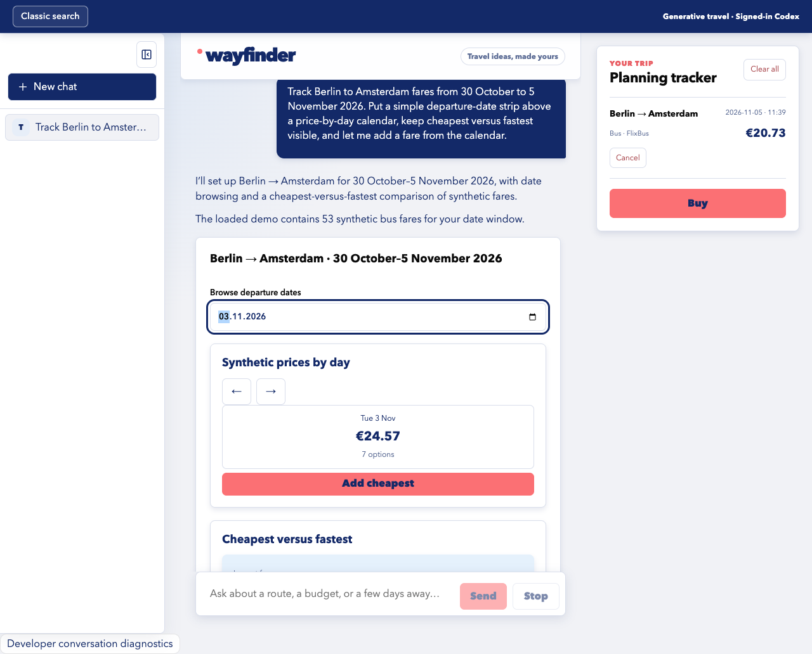
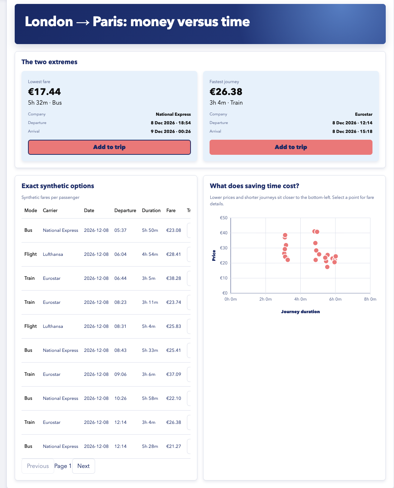
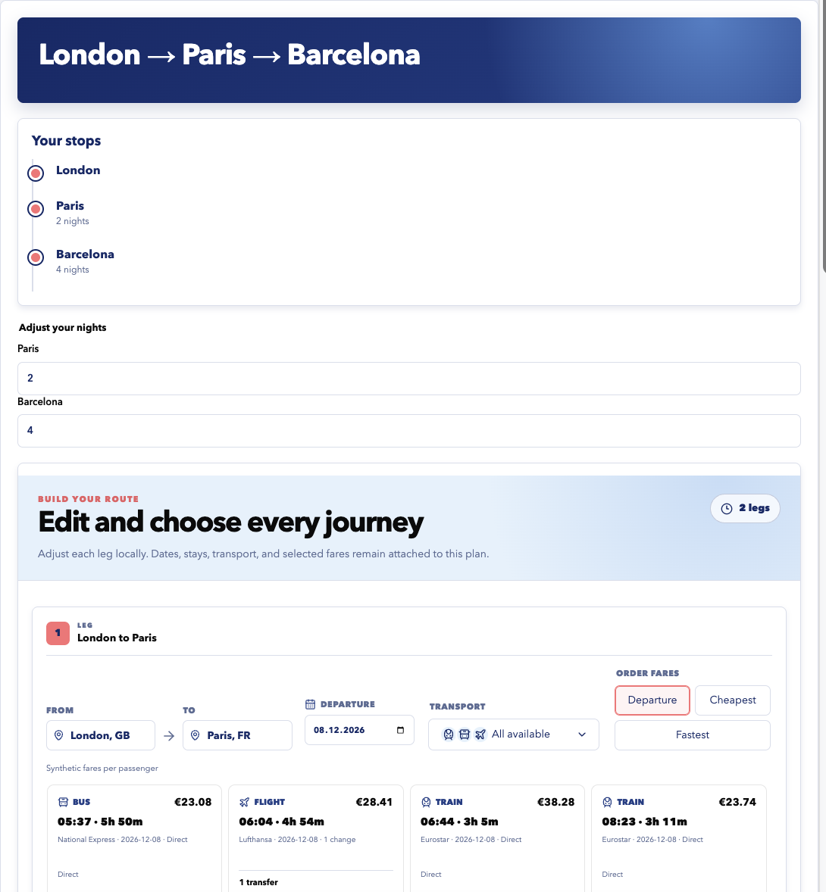

# Wayfinder

Wayfinder is an unofficial Omio generative UI study. It pairs a familiar travel search with a conversational planner that composes interactive React views from a fixed catalog, then binds them to deterministic synthetic fare data.

**[Open the GitHub Pages project presentation](https://ardaozd.github.io/omio-gen-ui-demo/)**

> The Pages site is a static case study with recorded captures. Run the repository locally for search, local SQLite data, and signed-in Codex composition.

[](https://ardaozd.github.io/omio-gen-ui-demo/)

[Run on macOS](#run-on-macos) · [See how it works](#how-it-works) · [Inspect the data](#synthetic-fare-data) · [Verify the project](#verification)

## What is in the demo

- **Classic search** at `/` uses the local fare API for route, date, passenger, transport, sorting, and pagination controls.
- **Generative travel** at `/generative` asks the signed-in local Codex runtime to choose and compose registered UI components. The browser executes their typed actions and data requests.
- **One planning tracker** keeps selected fares independent of the current generated scene. Fares can be added, removed, and cleared while the conversation continues.
- **Durable local chats** keep messages, scene snapshots, compact state, and selected fare references in IndexedDB.
- **Bounded data access** keeps the 50 million row SQLite fixture behind fixed Python endpoints. The model receives compact route and selection context, not database rows or SQL access.

All routes, timetables, prices, availability, and booking actions are generated examples. Nothing in this repository is live or bookable inventory.

<table>
  <tr>
    <td width="50%"></td>
    <td width="50%"></td>
  </tr>
  <tr>
    <td><strong>Decision views</strong><br>Exact synthetic fares can become tables, comparisons, calendars, and interactive plots.</td>
    <td><strong>Multi-city planning</strong><br>Each leg keeps its own dates, stay, transport, ordering, and selected fare.</td>
  </tr>
</table>

The [project presentation](https://ardaozd.github.io/omio-gen-ui-demo/) has more captured compositions, their component choices, and the technical request flow.

## Run on macOS

### Prerequisites

| Requirement | Why it is needed |
| --- | --- |
| A current macOS release on Apple silicon or Intel | The setup helper checks the required commands and versions instead of relying on one macOS release number. |
| Git | Clone the repository. Apple's Command Line Tools provide it. |
| Node.js 20.19+ within the 20.x line, or 22.12+ | Install and run the React, Vite, TypeScript, and agent services. |
| Python 3.11 or newer | Generate and serve the SQLite fixture. The backend has no pip dependencies. |
| Codex installed and signed in | Generate conversational planner scenes. The signed-in account must have access to `gpt-6.1-sol` at high reasoning. The app does not use an API key. |
| At least 18 GiB free before data generation | The completed 50 million row fixture is about 7.7 GiB. Generation uses a temporary database before replacing the target. |
| Google Chrome | Run the Playwright browser suite. It is optional for normal use. |

Clone and start the project:

```sh
git clone https://github.com/ArdaOzd/omio-gen-ui-demo.git
cd omio-gen-ui-demo
npm ci
npm run dev
```

The first start generates `data/omio.sqlite3` if it is missing, validates its contract, then starts three loopback-only services. Building and checking 50 million rows can take several minutes or longer, and the verifier stays quiet during its full-table scans.

| Service | Address |
| --- | --- |
| Classic search | <http://127.0.0.1:5173/> |
| Generative travel | <http://127.0.0.1:5173/generative> |
| Fare API health | <http://127.0.0.1:8000/api/health> |
| Agent health | <http://127.0.0.1:8010/api/agent/health> |

Keep the Terminal window open. Press `Control-C` once to stop all three services. The launcher refuses occupied ports instead of attaching to an unrelated process.

You can also double-click [`Start Omio Demo.command`](Start%20Omio%20Demo.command) in Finder. macOS may ask you to confirm the first launch.

### Let a coding agent set it up

The repository includes a portable setup skill at [`.agents/skills/setup-omio-macos/SKILL.md`](.agents/skills/setup-omio-macos/SKILL.md). After cloning the repository and opening it in Codex, paste this prompt:

```text
Set up this repository on my Mac by following .agents/skills/setup-omio-macos/SKILL.md.
Check the prerequisites, install only what is missing, generate and verify the fare
database, start the app, and prove both interfaces and health endpoints work.
Explain any macOS prompt before I need to act on it.
```

The skill handles Apple silicon and Intel Homebrew paths, checks compatible Node and Python versions, finds an installed Codex binary, and leaves a verification record. It does not assume the original author's directories.

### Local configuration

The defaults are API port `8000`, agent port `8010`, and web port `5173`. Override them for one run when needed:

```sh
API_PORT=8094 AGENT_PORT=8095 WEB_PORT=5194 npm run dev
```

Use an existing compatible fixture with `OMIO_DATABASE=/absolute/path/omio.sqlite3`. Set `CODEX_BINARY=/absolute/path/to/codex` if automatic discovery cannot find your installation.

The generative planner requires a working local Codex sign-in. There is no API-key mode. A request fixture exists for narrow transport tests, but it returns text only and cannot compose planner scenes.

For a production build served locally:

```sh
npm start
```

Then open <http://127.0.0.1:4173/generative>.

## How it works

[](site/assets/architecture-system.svg)

1. The browser sends the agent a compact snapshot of the current route, dates, filters, and selected fare references.
2. The local Codex process returns text plus at most one catalog tool call. It has no shell, web, app, plugin, MCP, or network access for this task.
3. The host validates the scene, component names, references, and size limits before rendering registered React components.
4. User controls dispatch typed browser actions. Fixed projection requests go to the Python API, which runs bounded read-only SQLite queries.
5. The planning tracker and persisted conversations stay browser-owned, so a newly generated scene cannot replace their state.

The current stack is [React](https://react.dev/) 19, [Vite](https://vite.dev/) 7, [TypeScript](https://www.typescriptlang.org/) 5.9, [AI SDK](https://ai-sdk.dev/) 7, [assistant-ui](https://www.assistant-ui.com/) 0.15, a dependency-free Python HTTP service, and SQLite. Exact resolved versions live in `package-lock.json`.

## Synthetic fare data

The database is generated locally and ignored by Git. Its inputs and generator are tracked:

- [`backend/seeds.py`](backend/seeds.py) defines 120 cities in strict geographic Europe, carriers, corridors, gateways, and route topology.
- [`backend/generate_db.py`](backend/generate_db.py) deterministically creates exactly 50,000,000 fares for every ordered city pair on every day from 8 October 2026 through 31 December 2027.
- [`backend/verify_db.py`](backend/verify_db.py) checks the row count, schema, date and geographic contracts, coverage, route legs, indexes, and SQLite integrity.

Create or replace the fixture, then verify it:

```sh
npm run seed
python3 -m backend.verify_db data/omio.sqlite3 --expected-rows 50000000
```

Generation writes a temporary database, verifies it, and atomically replaces the target. `npm run dev` also checks the saved contract before starting the API, so an old or partial fixture fails with a direct error instead of producing misleading results.

The API surface and query parameters are documented in [`backend/README.md`](backend/README.md).

## Verification

Run the repository checks from the project root:

```sh
npm run typecheck
npm run check:catalog
npm test
python3 -m unittest discover -s backend/tests -v
npm run build
```

With Google Chrome installed, run the browser suite:

```sh
npm run test:browser
```

With the app running, check the two owned services directly:

```sh
curl --fail http://127.0.0.1:8000/api/health
curl --fail http://127.0.0.1:8010/api/agent/health
```

The agent health endpoint proves that the local service started. Complete setup verification also sends one planner prompt and waits for a rendered scene, which confirms the Codex sign-in and model access.

Additional acceptance evidence lives under [`verification/generative-ui/`](verification/generative-ui/). The repository labels deterministic renderer fixtures and real model captures separately.

## Repository map

| Path | Purpose |
| --- | --- |
| `src/` | Classic search, generative UI, component catalog, state, and persistence |
| `agent/` | Loopback agent service and restricted signed-in Codex adapter |
| `backend/` | Deterministic generator, verification, fare API, and backend tests |
| `site/` | Static GitHub Pages project presentation and tracked public captures |
| `tests/browser/` | Chrome browser checks |
| `verification/` | Capability audits and end-to-end evidence |
| `.agents/skills/` | Portable project setup instructions for coding agents |

## Project status and attribution

Development starts from `dev`; stable releases live on `main`. See [`CONTRIBUTING.md`](CONTRIBUTING.md) for the branch and pull request workflow.

This is an independent, non-production interface study. It is not affiliated with or endorsed by Omio. Omio names and reference assets remain the property of their owners; [`public/assets/omio/SOURCES.md`](public/assets/omio/SOURCES.md) records the asset sources.
